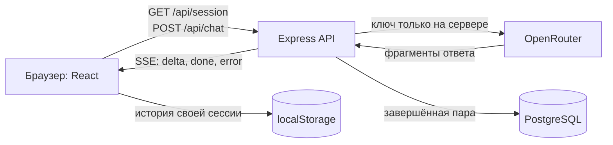

# AI Gate

AI Gate — небольшое приложение для вопросов нейросети без регистрации. Ответ появляется по мере генерации; завершённые запросы остаются в истории текущей анонимной сессии.

**Работающая версия:** [ai-gate-one.vercel.app](https://ai-gate-one.vercel.app/).

## Возможности

- Запрос от 1 до 500 символов отправляется кнопкой или по Enter; Shift+Enter добавляет новую строку.
- Ответ приходит частями через SSE и отображается как Markdown: заголовки, списки, ссылки и блоки кода.
- Завершённая пара «запрос — ответ» сохраняется в PostgreSQL. Каждая карточка истории сначала показывает только запрос и кнопку «Развернуть»; после раскрытия видны полный Markdown-ответ и дата.
- История текущей сессии восстанавливается после обновления страницы из `localStorage`. У другой анонимной сессии своя история.

## Как это работает



API создаёт анонимную сессию и хранит её ID в подписанной `HttpOnly` cookie. После успешного ответа сервер записывает полную пару в PostgreSQL, а браузер сохраняет копию для отображения истории. Серверного маршрута для чтения истории из БД нет; история одного браузера не переносится в другой. Предыдущие запросы не отправляются модели как контекст.

Локально Vite направляет `/api/*` в Express на компьютере. На Vercel тот же интерфейс отдаётся как статические файлы, а `/api/session` и `/api/chat` работают через Node Functions. Облачная база — Neon PostgreSQL; локальная база запускается в Docker. Код находится в `apps/web`, `apps/api`, `api` и `db`.

## Локальный запуск

Нужны Node.js 24+, npm, Docker Desktop и ключ OpenRouter. По умолчанию используется бесплатный маршрут `openrouter/free`; модель можно изменить через `OPENROUTER_MODEL`.

Из корня проекта скопируйте пример настроек:

```powershell
Copy-Item .env.example .env
```

В `.env` впишите `OPENROUTER_API_KEY` и замените `COOKIE_SECRET` длинным случайным секретом. Значение `DATABASE_URL` из примера уже указывает на локальный контейнер. Не добавляйте `.env` в Git. Затем установите зависимости и запустите базу:

```powershell
npm ci
docker compose up -d db
```

В двух терминалах из корня проекта запустите API и интерфейс:

```powershell
npm run dev:api
```

```powershell
npm run dev:web
```

Откройте [http://127.0.0.1:5173](http://127.0.0.1:5173). API слушает `127.0.0.1:3001`, PostgreSQL — `127.0.0.1:5433`. Сборка перед локальным запуском не требуется. Подробнее: [локальный запуск](docs/04-local-run.md).

## Проверки

После запуска локальной PostgreSQL можно выполнить:

```powershell
npm test --workspaces
npm run typecheck --workspaces
npm run build --workspaces
npm run test:vercel-runtime
```

Фактические результаты записаны в [проверке приложения](specs/001-ai-gate-demo/verification.md), [проверке деплоя](specs/002-vercel-deployment/verification.md) и [проверке сворачивания истории](specs/003-history-collapse/verification.md).

## Развёртывание

Проект развёрнут на Vercel как один проект из корня репозитория: Vite собирает `apps/web/dist`, а серверные функции используют скомпилированный API. Для PostgreSQL подключён Neon Free. Серверу нужны `COOKIE_SECRET`, `OPENROUTER_API_KEY` и `DATABASE_URL`; `OPENROUTER_MODEL` необязательна (по умолчанию `openrouter/free`). Значения секретов не хранятся в репозитории. Пошаговая инструкция для повторного развёртывания и проверки — в [docs/05-vercel-deploy.md](docs/05-vercel-deploy.md).

## Документация и Spec Kit

Работа разделена на [фичи](docs/README.md). Для каждой есть спецификация, план, задачи и журнал проверки: [основное приложение](specs/001-ai-gate-demo/spec.md), [публикация на Vercel](specs/002-vercel-deployment/spec.md) и [сворачивание истории](specs/003-history-collapse/spec.md). Проектные принципы закреплены в [конституции Spec Kit](.specify/memory/constitution.md).
