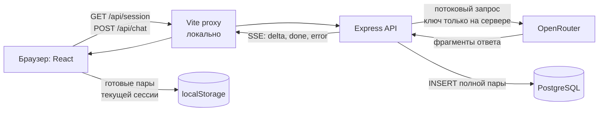

# AI Gate

AI Gate — небольшое приложение, в котором можно задать вопрос нейросети без регистрации и наблюдать, как ответ появляется по мере генерации. Готовые ответы остаются в истории текущей анонимной сессии.

**Онлайн-версия:** пока не опубликована. Ссылка появится здесь после развёртывания.

## Возможности

- Запрос до 500 символов отправляется кнопкой или по Enter; Shift+Enter добавляет новую строку.
- Ответ поступает частями и отображается как Markdown: с заголовками, списками, ссылками и блоками кода.
- Завершённые запросы сохраняются в истории. Длинные ответы в списке свёрнуты по умолчанию — их можно раскрыть.
- После обновления страницы история этой сессии восстанавливается из браузера. Для новой анонимной сессии она не показывается.

## Как работает



При первом открытии API создаёт анонимную сессию и сохраняет её ID в подписанной `HttpOnly` cookie. Регистрация и учётная запись не нужны.

Express отправляет запрос в OpenRouter с ключом из серверного окружения и передаёт фрагменты ответа браузеру через SSE. Интерфейс показывает их сразу. Когда ответ завершён, сервер записывает полную пару «запрос — ответ» в PostgreSQL, а браузер добавляет её в `localStorage`. Так история остаётся видимой после обновления страницы. Предыдущие запросы не отправляются модели как контекст.

Код разделён на `apps/web` (React и Vite), `apps/api` (Express и потоковый API) и `db` (схема PostgreSQL).

## Локальный запуск

Нужны Node.js 24+, npm, Docker Desktop и ключ OpenRouter. По умолчанию используется бесплатный маршрут `openrouter/free`; при необходимости модель можно изменить через `OPENROUTER_MODEL`.

Создайте файл окружения из примера:

```powershell
Copy-Item .env.example .env
```

В `.env` заполните `OPENROUTER_API_KEY` и замените `COOKIE_SECRET` длинным случайным секретом. Файл `.env` не добавляется в Git. Затем запустите PostgreSQL и установите зависимости:

```powershell
docker compose up -d db
npm ci
```

Запустите API и интерфейс в двух терминалах из корня проекта:

```powershell
npm run dev:api
```

```powershell
npm run dev:web
```

Откройте [http://127.0.0.1:5173](http://127.0.0.1:5173). Локально API работает на `127.0.0.1:3001`, PostgreSQL — на `127.0.0.1:5433`. Предварительная сборка для разработки не нужна.

## Разработка по SDD и Spec Kit

В проекте используется **SDD (Spec-Driven Development)**: сначала описываем ожидаемое поведение, затем планируем реализацию, делим её на задачи и проверяем результат. Для этого в репозитории установлен **Spec Kit**.

Артефакты каждой фичи лежат в `specs/`. Для AI Gate путь выглядит так: [спецификация](specs/001-ai-gate-demo/spec.md) с требованиями → [план](specs/001-ai-gate-demo/plan.md) с архитектурой → [задачи](specs/001-ai-gate-demo/tasks.md) → [анализ](specs/001-ai-gate-demo/analysis.md) согласованности документов → реализация с тестами → [журнал проверки](specs/001-ai-gate-demo/verification.md) с фактическими результатами. Общие правила закреплены в [конституции](.specify/memory/constitution.md), а описания готовых фич простым языком — в [docs](docs/README.md).