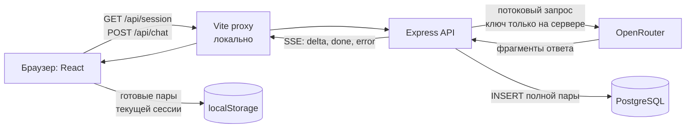

# AI Gate

Небольшое приложение для тестового задания: посетитель без регистрации задаёт вопрос и видит ответ бесплатной модели по мере генерации. Завершённые запросы сохраняются в PostgreSQL и показываются в истории браузера.

## Что проверить в интерфейсе

- Форма принимает запрос от 1 до 500 символов. Enter отправляет его, Shift+Enter добавляет строку. После успешного ответа поле очищается; при ошибке текст остаётся.
- Ответ появляется частями и отображает базовый Markdown: заголовки, выделение, списки, ссылки и код.
- История показывает завершённые пары. Длинные ответы сначала сокращены до 180 символов и раскрываются по кнопке; после обновления страницы история сохраняется.
- Учётная запись не нужна. Новая анонимная сессия не видит историю предыдущей.

## Архитектура



1. API выдаёт идентификатор анонимной сессии в подписанной `HttpOnly` cookie. Браузер отправляет запрос через Vite proxy на тот же origin.
2. Express проверяет длину запроса и обращается к OpenRouter с серверным `OPENROUTER_API_KEY`. Модель задаётся переменной `OPENROUTER_MODEL`; по умолчанию — `openrouter/free`.
3. API передаёт фрагменты браузеру как SSE-события `delta`. React показывает их сразу и форматирует текст как Markdown. Сырой HTML из ответа не выполняется.
4. После полного ответа API записывает пару в PostgreSQL и отправляет `done`. Тогда браузер сохраняет пару в `localStorage` под ID текущей сессии. При обрыве или ошибке сохранения успешного `done` нет.

| Где | Что хранится | Для чего |
| --- | --- | --- |
| PostgreSQL, таблица `exchanges` | ID записи, ID сессии, запрос, полный ответ, время | Серверная история завершённых запросов |
| `localStorage` браузера | Завершённые пары для ID текущей сессии | Показ истории после обновления страницы |
| Подписанная cookie | ID анонимной сессии | Привязка запросов без регистрации |

Интерфейс восстанавливает историю из `localStorage`. Маршрута чтения истории из PostgreSQL в этом минимальном этапе нет; предыдущие запросы не передаются модели как контекст.

## Локальный запуск

Нужны **Node.js 24+**, npm, Docker Desktop, интернет и ключ OpenRouter с доступом к бесплатному маршруту.

1. В корне проекта создайте `.env` из примера: `Copy-Item .env.example .env`. Укажите свой `OPENROUTER_API_KEY` и замените `COOKIE_SECRET` длинным случайным секретом. Файл `.env` игнорируется Git.
2. Поднимите PostgreSQL и установите зависимости:

   ```powershell
   docker compose up -d db
   npm ci
   ```

3. Откройте два терминала в корне репозитория:

   ```powershell
   npm run dev:api
   ```

   ```powershell
   npm run dev:web
   ```

4. Откройте [http://127.0.0.1:5173](http://127.0.0.1:5173). API слушает `127.0.0.1:3001`, PostgreSQL доступна только локально на `127.0.0.1:5433`. Для режима разработки предварительная сборка не нужна.

## Сценарий приёмки

1. Отправьте короткий запрос по Enter и убедитесь, что текст появляется до завершения ответа. Проверьте Markdown, например попросите модель дать список и блок кода.
2. После завершения проверьте, что поле пустое, а пара добавилась в историю. Раскройте длинный ответ, сверните его и обновите страницу: история должна остаться, а длинный ответ — снова быть свёрнутым.
3. Проверьте Shift+Enter, пустой запрос и текст длиннее 500 символов. При ошибке API исходный запрос должен оставаться в поле.
4. Откройте страницу в отдельном окне инкогнито и отправьте другой запрос. История обычного окна там не показывается.
5. Проверьте записи PostgreSQL:

   ```powershell
   docker compose exec db psql -U ai_gate -d ai_gate -c "SELECT session_id, prompt, answer, created_at FROM exchanges ORDER BY created_at;"
   ```

   У успешно завершённых запросов должны быть строки; у независимых сессий — разные `session_id`. При сбое генерации новая строка не создаётся.

## Автоматические проверки

```powershell
npm test --workspaces
npm run typecheck --workspaces
npm run build --workspaces
```

Результаты выполненных проверок и их ограничения записаны в [журнале проверки](specs/001-ai-gate-demo/verification.md). Подробности по слоям работы — в [документации фич](docs/README.md), контракт API — в [спецификации](specs/001-ai-gate-demo/contracts/api.md).

## Границы текущего результата

Это локальная версия для проверки тестового задания. Публикация ещё не выполнялась. Доступность бесплатного маршрута и качество ответа зависят от OpenRouter; настоящий запрос с пользовательским ключом проверяется при локальной приёмке.